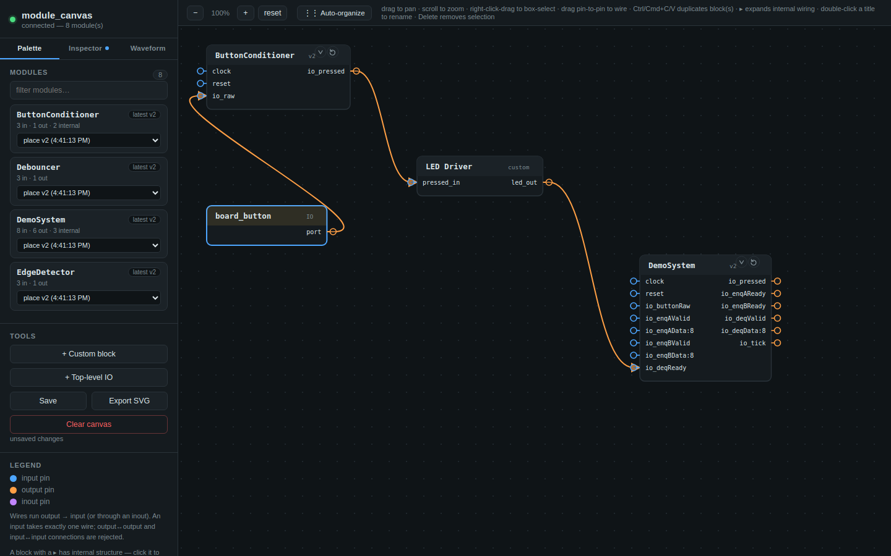
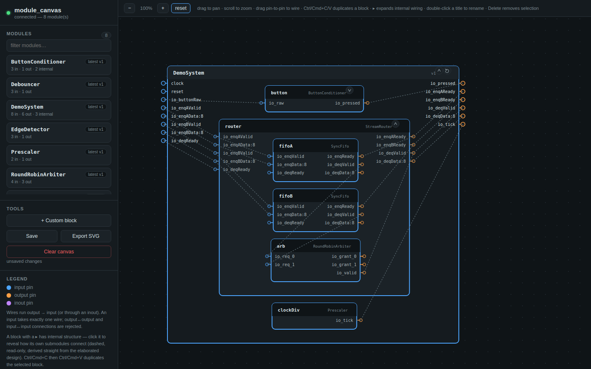
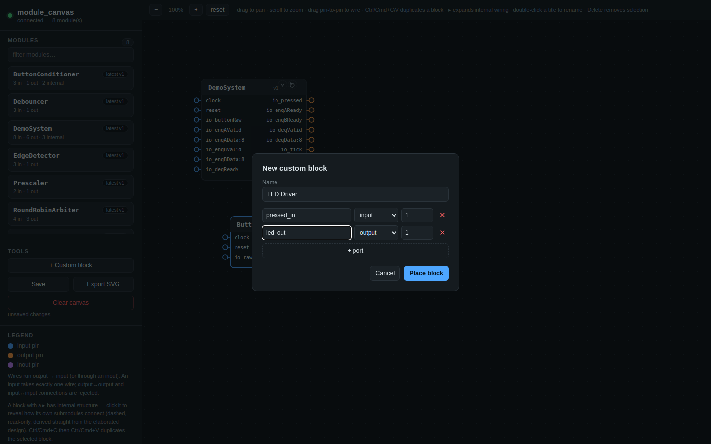
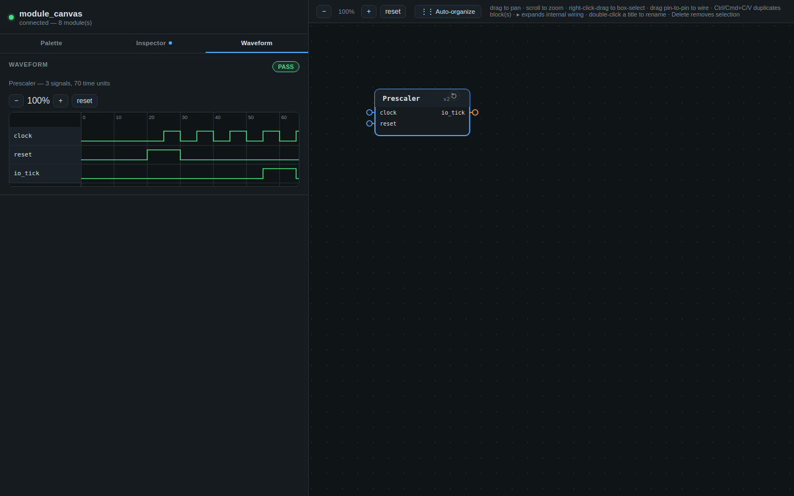

# module_canvas

A small background server + browser canvas for sketching how your Chisel
modules wire together — without leaving your build or your notebook.

Point it at any elaborated Chisel module and it shows up as a draggable
block with its real, flattened IO. Blocks with submodules can be expanded
in place to reveal how those submodules actually connect — recovered
straight from CIRCT's elaboration output, not hand-drawn. Wiring between
blocks is direction-checked as you draw it: no shorting two outputs
together, no leaving an input undriven by wiring it to another input.

Point `server/register_notebook.py` at a Chisel/Almond notebook and every
module it defines shows up in the palette with no `registerModule` calls
written by hand; any `simulate(new X) {...}` test cell you've already
written becomes a "Run test" button on that block, complete with a
waveform viewer once it passes or fails.



## Why

Block diagrams for a hardware design normally mean either redrawing the
hierarchy by hand in a separate tool (which drifts the moment the RTL
changes) or reading the generated Verilog port list and inferring the
shape yourself. `module_canvas` instead asks Chisel directly, every time
you register a module: it flattens the real `IO()` bundle the same way
CIRCT flattens it for SystemVerilog, and — for a parent module — recovers
its submodules' direct interconnect from the CHIRRTL text CIRCT emits
during elaboration. What you place on the canvas is what your design
actually looks like as of the last time you ran `registerModule`.

## What's in this repo

```text
.
├── server/                     # the tool itself — run this, point a browser at it
│   ├── server.py               # stdlib-only Python HTTP server (no pip install needed)
│   ├── register_notebook.py    # scans a .ipynb and auto-registers every module + test in it
│   ├── vcd_parser.py           # pure-Python VCD reader for the waveform viewer
│   └── static/                 # the canvas frontend: index.html, app.js, style.css
├── examples/                    # a small, fully dummy Chisel project to try it against
│   ├── build.sbt
│   ├── DemoNotebook.ipynb       # the same demo modules + a few tests, as a notebook
│   └── src/main/scala/
│       ├── modulecanvas/        # ModuleRegistry + HierarchyParser — the Chisel-side library
│       └── demo/                # DemoSystem and friends — see docs/examples.md
└── docs/
    ├── usage-guide.md            # every interaction, in detail
    ├── examples.md                # walk through the screenshots above, step by step
    └── images/                    # screenshots used in this README and the guides
```

## Quickstart

```bash
# 1. Launch the server (zero dependencies — just Python's standard library)
python3 server/server.py
# -> http://127.0.0.1:8765

# 2. In another terminal, register the bundled dummy modules — either:

# (a) the notebook workflow: scans DemoNotebook.ipynb, registers every
#     module it defines and every simulate(...) test cell, no manual
#     ModuleRegistry calls required
python3 server/register_notebook.py examples/DemoNotebook.ipynb --sbt-dir examples

# (b) the plain-sbt workflow: an explicit RegisterDemo driver
cd examples && sbt "runMain demo.RegisterDemo"

# 3. Open the canvas
open http://127.0.0.1:8765/   # or just point a browser at it
```

Click a module in the left palette to place it, drag from a pin to another
pin to wire two blocks together, and click the `▸` on `DemoSystem` to see
its internal structure. If you used the notebook workflow, open a block
that has tests (`Debouncer`, `Prescaler`) from the Inspector tab and hit
"Run test" to see it simulate and trace a waveform. Full interaction
reference: `docs/usage-guide.md`. Full walkthrough of the bundled example:
`docs/examples.md`.

## Using it in your own project

Copy `examples/src/main/scala/modulecanvas/` (two files, zero dependencies
beyond Chisel and the JDK's built-in `java.net.http` client) into your own
project, then call it wherever you already elaborate a module — a plain
`sbt run`, a test, or a notebook cell:

```scala
import modulecanvas.ModuleRegistry

ModuleRegistry.registerModule(new YourTopModule)
```

That's it. Run it again after you change the module and the canvas offers
both versions — "latest" is always what you last registered, but nothing
is thrown away. See `docs/usage-guide.md` for the notebook-specific setup
(Almond/Ammonite kernels don't share a classpath with a compiled project,
so there's a copy-pasteable version of the same code) and for everything
the canvas itself can do.

## Internal wiring: what's real and what isn't

A block with a `▸` next to its title has submodules. Expanding it shows
them laid out inside, wired exactly as CIRCT's CHIRRTL output says they're
wired — dashed and read-only, since it's derived, not drawn. This works
well for straight pass-through connections, which is most interconnect in
a typical design. A signal computed through a `Mux`, a bit-slice, or any
other expression isn't traced back to its true source, so that particular
port simply won't show an internal wire — no guessing. Details and the
exact scope of what's recovered are in `docs/usage-guide.md`.



## Everything else

- **Auto-load from a notebook** — `server/register_notebook.py` scans any
  Chisel/Almond `.ipynb`, finds every `class ... extends Module`, and
  generates + runs the sbt driver that registers each one — no
  `registerModule` boilerplate in the notebook at all. It also detects any
  `simulate(new X) {...}` test cell for a module (more than one is fine —
  every one shows up) and wires it up as that block's "Run test" button.
- **Per-block tests + waveform viewer** — a module with a detected test
  gets a "Tests" section in the Inspector tab; "Run test" runs it through
  `sbt` in the background (queued, not dropped, if you fire off several at
  once) and a passing or failing run gets a "view waveform" link that
  opens a real, zoomable VCD trace on the Waveform tab.
- **Notes** — the Inspector tab has a free-text note field per block,
  saved with the canvas — a place to write down why a block is wired the
  way it is, without cluttering the diagram itself.
- **Top-level IO markers** — "+ Top-level IO" places a single-port marker
  block (dashed amber outline) you wire straight to a pin, to mark it as
  part of the system's external interface rather than internal glue.
- **Auto-organize layout** — the toolbar's "Auto-organize" re-lays-out
  every block left-to-right by data flow (a layered, crossing-minimizing
  pass), for when manual placement has turned into a criss-cross of wires.
- **Multi-select** — right-click-drag a box over several blocks to select
  them together, then move, copy/paste, or delete the whole group at
  once; `Shift`-click adds or removes one block from the selection.
- **Custom blocks** — not every box needs to come from Chisel. "+ Custom
  block" opens a small form to hand-draw a rectangle with your own named,
  directioned, sized ports — for glue logic, external IP, anything that
  isn't an elaborated module yet.
- **Duplicate a block** — select it, `Ctrl`/`Cmd`+`C`, then `Ctrl`/`Cmd`+`V`
  as many times as you need. Each paste is an independent instance;
  double-click a title to give it a meaningful name.
- **Connection rules** — output → input (or through an inout) is allowed;
  output ↔ output and input ↔ input are rejected outright; an input takes
  exactly one wire.
- **Versioning** — every `registerModule` call adds a new version rather
  than overwriting the last one, so you can place an older version
  deliberately, or hit the refresh icon on a placed block to jump it to
  whatever's newest.
- **Save / export** — the canvas autosaves locally and reloads on next
  open; "Export SVG" downloads a static, self-styled snapshot of whatever
  you've built.





## Design notes

- **Zero third-party dependencies on the server.** `python3 server/server.py`
  should just work next to whatever Python or Scala toolchain your project
  already has, without installing anything into it.
- **Push-based, not auto-detected.** Nothing watches your build or your
  notebook kernel in the background. Either you call `registerModule`
  for whatever you want tracked, or you re-run `register_notebook.py`
  after editing the notebook — both are things you do on purpose, not
  something that happens on save.
- **A diagram tool, not a simulator.** Connections are checked for
  direction legality, not bit-width compatibility — wiring a 4-bit pin to
  an 8-bit pin is drawn without complaint.

## Author

Srimanth Tenneti

This is a private repository; no license is granted for use outside it
unless one is added later.
